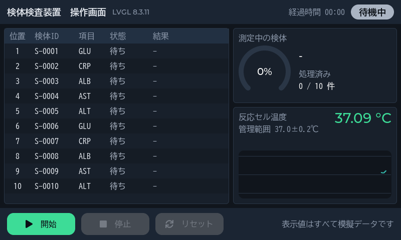
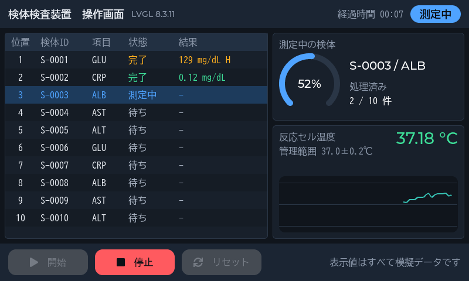
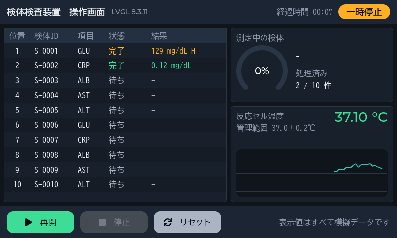
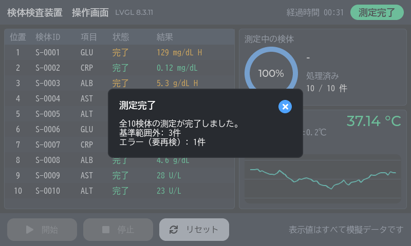
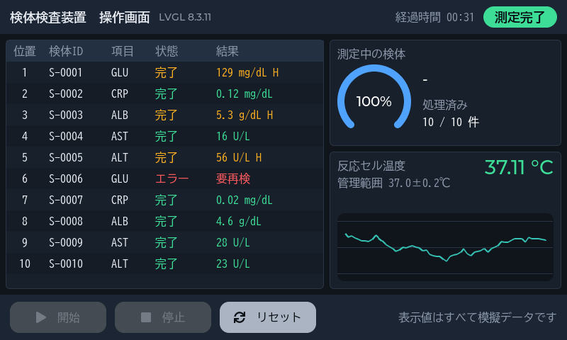

# 検体検査装置の操作画面（LVGL 8.3.11 による試作）

組込み Linux 機器の GUI でよく使われる **LVGL 8.3.11** で、検体検査装置の操作画面（800×480 のタッチパネル想定）を
PC 上で試作しました。要件定義・設計・単体テスト・画面の自動テストまでを一通り行っています。

**[▶ ブラウザで実際に操作する（スマートフォン可）](https://shinbaru0422.github.io/lvgl-analyzer-demo/demo/)**
— 同じ C++ のコードを WebAssembly にしたものです。スマートフォンは横向きにすると大きく表示されます。


開始 → 停止 → 再開 → 完了 → 結果一覧（3 倍速。白い輪は押した位置）。値はすべて乱数による模擬データです。

## ポイント

- **LVGL の移植層を自作**: 表示・タッチ入力・時間の 3 つを自分で実装。表示先と入力元をインターフェースで分けたので、実機では `/dev/fb0`（fbdev）と `evdev` の実装に差し替えるだけで済む。実際に、この 2 つをブラウザ用に差し替えるだけでブラウザ版ができた
- **GUI と装置制御のスレッド分離**: LVGL はスレッドセーフではないため、LVGL を呼ぶのは GUI スレッドだけ。装置制御は別スレッドで動かし、画面へは表示データのコピーをキューで渡す
- **日本語フォントを生成**: LVGL 公式の `lv_font_conv` で、画面に出る 82 字だけを BIZ UDゴシックから C 配列に変換（約 12.5 KB）
- **LVGL に依存しない設計**: 検査の進行と表示文言の生成は LVGL 無しでビルドでき、単体テスト 16 件で検証
- **画面の自動テスト**: 画面上のボタンを文字で探して仮想タッチで押す手順を再生し、5 場面の画面を期待値と照合。フォントに無い字も検出する

## ドキュメント

| 文書 | 内容 |
|---|---|
| [要件定義書](docs/requirements.md) | 目的・前提、機能要件、非機能要件、対象外 |
| [設計書](docs/design.md) | 層構成、状態遷移、スレッド設計、LVGL 移植層、画面・フォント、実機 Linux への移植方針 |
| [テスト仕様書兼成績書](docs/test-report.md) | テストと要件の対応、実施結果、わざと誤りを入れた検出確認 |

<details>
<summary>画面写真（5 場面）</summary>

| 場面 | 画面 |
|---|---|
| 待機中 |  |
| 測定中（3 本目を測定中。1 本目は基準範囲外で H） |  |
| 一時停止（測定中だった 3 本目は「待ち」に戻る） |  |
| 測定完了（集計のダイアログ） |  |
| 結果一覧（6 本目はエラーで要再検） |  |

</details>

## 動かし方

Windows・Visual Studio 2022（MSVC）・CMake 3.20 以上が必要です。LVGL は git の submodule なので `--recursive` を付けて取得します
（LVGL は v8.3.11 の 1 コミット分だけを取得する設定にしています）。

```powershell
git clone --recursive https://github.com/shinbaru0422/lvgl-analyzer-demo.git
cd lvgl-analyzer-demo
cmake -S . -B build -G "Visual Studio 17 2022" -A x64
cmake --build build --config Release
ctest --test-dir build -C Release --output-on-failure    # 単体テスト + 画面の自動テスト

.\build\Release\lvgl_analyzer_demo.exe               # ウィンドウ版。マウスをタッチパネル代わりに操作する
.\build\Release\lvgl_analyzer_demo.exe --autostart   # 起動と同時に測定を始める
```

「開始」を押すと 10 検体を 1 本 3 秒で順に測定します（全件で約 30 秒）。途中で「停止」→「再開」、完了後に「リセット」ができます。
実行ファイルは VC++ ランタイムを静的リンクしており、依存する DLL は Windows 標準のもの（USER32・GDI32・KERNEL32）だけです。

ブラウザ版（`docs/demo/index.html` に出力。Emscripten SDK 6.0.13 を `tools/emsdk/` に入れて PowerShell で実行）:

```powershell
& .\tools\build_web.ps1
```

ヘッドレス版（ウィンドウを出さない。OS に依存しない）:

```powershell
.\build\Release\lvgl_analyzer_headless.exe --verify tests\golden\screen_hashes.txt   # 画面の自動テスト
.\build\Release\lvgl_analyzer_headless.exe --snapshot <新しいフォルダ>                # 5 場面を BMP で保存
.\build\Release\lvgl_analyzer_headless.exe --gif <ファイル名>.gif                    # 操作の様子を GIF にする
```

## 構成

```
src/
  domain/    検体・検査項目（基準範囲判定）・ラック・温度管理範囲   ← 何にも依存しない
  usecase/   検査の進行と入出力ポート（インターフェース）
  adapter/   Presenter（状態 → 表示文言）・View の抽象・スレッドの境界
  infra/     LVGL の移植層と画面・制御スレッド・模擬装置・GIF 出力
  app/       配線（Composition Root）
config/lv_conf.h     LVGL の設定
tools/gen_fonts.ps1  日本語フォントの生成
tests/               単体テスト・画面の自動テストの期待値
```

依存の向きは `infra → adapter → usecase → domain` の一方向で、CMake のターゲットも層ごとに分けています。

## 技術要素

C++20 / C99、LVGL 8.3.11（ソフトウェア描画）、CMake、MSVC（Visual Studio 2022）、Emscripten 6.0.13（WebAssembly）、std::thread、lv_font_conv 1.5.3

## 確認していないこと

- 実機（組込み Linux・実際のタッチパネル）での動作。PC 上のシミュレータとブラウザでのみ確認しています
- ウィンドウ版をマウスで操作する確認の一部（[テスト成績書](docs/test-report.md) の 4 章）

## フォントの作り直し

画面の文言を変えたときだけ必要です（ビルドには不要）。Node.js v24 のポータブル版を `tools/node-v24.22.1-win-x64/` に置き、
`npm install --prefix tools/fontconv` で lv_font_conv を入れてから、PowerShell で `& .\tools\gen_fonts.ps1` を実行します。

## ライセンス

自作のコードは [MIT License](LICENSE) です。LVGL・フォントなど第三者のものは [THIRD_PARTY_NOTICES.md](THIRD_PARTY_NOTICES.md) を参照してください。
